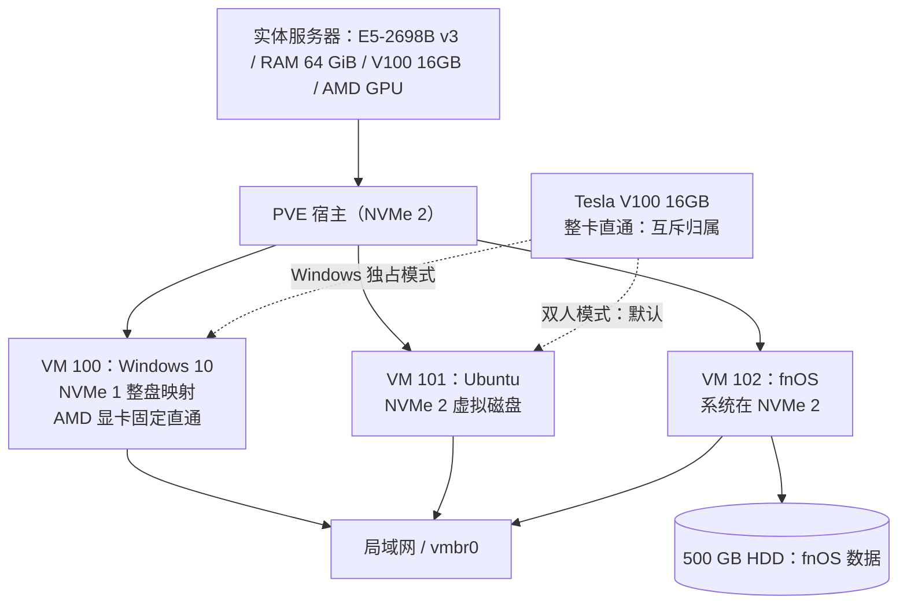

# VoltaShare — PVE 双计算用户部署方案（VS-PVE-001）

> 提案编号：**VS-PVE-001**；状态：**候选架构，尚未批准、尚未部署**；不代表当前实际架构。  
> 文档状态：**设计草案（尚未部署验证）**  
> 更新日期：2026-11-03  
> 目标：在固定硬件预算下，让 Windows 10 与 Ubuntu 用户各自拥有独立环境，平时并行在线，并能按需轮流获得整卡 V100、约 54 GiB 内存和全机 CPU 调度能力；fnOS NAS 服务尽量持续在线。

## 0. 与现有 VoltaShare 管理体系的关系

本文件提出一种可供决策的 **PVE 替代部署方案**：保留两名核心计算用户各自的 Windows 与 Ubuntu 环境，允许另外 1–3 名使用者经授权访问计算服务、SSH/API 和 fnOS 数据共享。请注意：当前 `README.md`、`docs/management-framework.md`（VS-MSD-001）和 `docs/usage-rules.md` 明确假定**单 Linux 宿主、Linux 账号、同一块 CUDA 卡受本地 flock 脚本协调**；PVE 方案改变了这些技术前提，不能理解为与原规范天然兼容。

- 在提案获批准之前，现有 [管理体系规范](management-framework.md) 和 [使用规约](usage-rules.md) 仍描述**原 Linux 单宿主方案**；不得用本提案里的参数冒充已实施配置。
- 该提案需要新的 **PVE 管理员操作规程**，对现有管理文档做版本修订，并为 Windows 与 Ubuntu 制定跨虚拟机 GPU 使用制度。详见 [迁移影响评估](pve-migration-impact.md)。
- 仓库已有 `scripts/gpu-run.sh`、`scripts/gpu-who.sh`，它们工作于 Linux 客体所在的用户态，**无法管理 Windows 客体或在宿主侧切换 VFIO 设备**。本提案不修改既有脚本。

## 1. 硬件清单与使用场景

| 组件 | 现有资源 | 用途 |
|---|---|---|
| CPU | Intel Xeon E5-2698B v3，16 核 / 32 线程（以实际主机检测为准） | 两位用户共享计算 |
| 物理内存 | 64 GiB（以 PVE 识别值为准） | 按工作模式切换配额 |
| GPU 1 | NVIDIA Tesla V100 PCIe，16 GB 显存 | CUDA 仿真 / Windows 模型推理，整卡**轮流**直通 |
| GPU 2 | AMD 亮机卡（具体型号待补充） | 固定直通 Windows，提供本地画面 |
| NVMe 1 | 256 GB（约 238.4 GiB） | Windows 10、Strata、Qwen、MiniMax H3 |
| NVMe 2 | 256 GB（约 238.4 GiB） | Proxmox VE 宿主、Ubuntu VM、fnOS 系统盘 |
| HDD | 500 GB（约 465.7 GiB） | fnOS **数据盘** |

### 两位用户的工作需求

- **用户 A：Windows 10**。日常桌面、开发；希望通过 Strata 运行 Qwen 模型，并尝试在兼容的推理软件中运行 MiniMax H3。Windows 本地需存储一份约 **60 GB 的 Qwen 权重**及 MiniMax H3 的**选定**权重版本；后者的准确模型标识、实际文件大小、许可和 V100 兼容实现须确认，不能用未经证实的容量估算代替验收。
- **用户 B：Ubuntu**。运行科研仿真，偶尔需要 CUDA GPU。双方同时在线时，**V100 默认属于 Ubuntu**。
- **公共服务：fnOS**。独立 VM 提供局域网文件共享，数据放置于 500 GB HDD，不因切换计算虚拟机而主动停止。

## 2. 总体架构

V100 的“共享”指**按模式在虚拟机之间转移整卡所有权**，并不意味着两台同时运行的虚拟机能各自独占显卡。PVE/VFIO 整卡直通不支持这样的同时独占。任何 GPU 迁移都应在相关虚拟机关机后完成。

## 3. 三种运行模式

> 内存值采用 **GiB**。初始保守目标是给 PVE、QEMU 开销及其他宿主服务总计留 **8 GiB** 预算；实际可用上限需要根据宿主内存占用、fnOS 业务及直通稳定性重新测量。

| 资源 | 双人在线（默认） | Windows 独占计算 | Ubuntu 独占计算 |
|---|---:|---:|---:|
| Windows 10 | 在线 | 在线 | 关闭 |
| Ubuntu | 在线 | 关闭 | 在线 |
| fnOS | 始终在线 | 始终在线 | 始终在线 |
| Windows RAM | 18 GiB | 54 GiB | — |
| Ubuntu RAM | 36 GiB | — | 54 GiB |
| fnOS RAM | 2 GiB | 2 GiB | 2 GiB |
| PVE / QEMU 余量 | 8 GiB | 8 GiB | 8 GiB |
| V100 16 GB | **Ubuntu** | **Windows** | **Ubuntu** |
| AMD 亮机卡 | Windows | Windows | 无活跃使用者 |
| Windows vCPU | 32 | 32 | — |
| Ubuntu vCPU | 32 | — | 32 |
| fnOS vCPU | 2 | 2 | 2 |

### CPU 策略

- Windows、Ubuntu 的 `cpu` 类型选择 `host`，各配置 32 vCPU（仅当宿主确实报告 32 个逻辑处理器时）。
- 两个计算 VM 同时运行时，32+32 vCPU 是**超额订阅**，不是 64 个物理线程；两个用户共享实际 16 核 / 32 线程的计算时间。
- 不进行固定 CPU 核心绑定作为初始方案；根据实际负载再考虑 CPU 权重或任务优先级，保证 fnOS 响应。

### 内存策略

- 使用**固定内存**，尤其是 V100 直通客体；不要把 Ballooning 视为“可以把两台虚拟机内存无缝切换至 54 GiB”的实现手段。
- 54 GiB 为初始独占配置，**不是承诺的物理最大值**。经过测量后，可以尝试 55–56 GiB，但必须避免宿主 OOM/Swap 抖动。
- 切换到高内存独占模式须先关闭对应计算 VM，修改固定内存，再启动；内存不会自动迁移。
- 如果 fnOS 增加 Docker、媒体索引等任务，先将 fnOS RAM 提到 4 GiB，并减少独占模式的计算 VM RAM。

### GPU 策略

- 双人在线：V100 的 16 GB 显存和全部 CUDA 计算资源由 Ubuntu 独占；Windows 仍正常运行，但不能本机使用这张 V100 推理。
- Windows 独占：停止 Ubuntu，关闭 Windows 以调整资源/直通配置，V100 转给 Windows；Windows 内存设为约 54 GiB。
- Ubuntu 独占：停止 Windows，V100 给 Ubuntu，内存设为约 54 GiB。
- AMD 亮机卡通常保持 Windows 专属；Ubuntu 通过 SSH、远程桌面或虚拟控制台使用。
- **待验证**：主板 VT-d、IOMMU 分组、V100/AMD 设备复位与再次直通、Ubuntu/Windows 驱动兼容性。不能保证反复切换 GPU 后无须重启宿主。

## 4. 存储分工（两块 NVMe + 一块 HDD）

### NVMe 1：Windows 10 专用，256 GB

优先保留 Windows 的系统、EFI 分区、软件和模型数据，按稳定设备 ID 进行整盘映射（不是让两个系统同时写同一个文件系统）。

| 预算项目 | 目标 |
|---|---:|
| Windows 10、驱动、更新 | 40–50 GiB |
| Qwen 权重 | 约 60 GB ≈ 55.9 GiB |
| MiniMax H3 **选定量化/优化权重** | 初步计划约 40–60 GiB；以实测版本为准 |
| Strata、推理工具、Python/ComfyUI、缓存 | 15–25 GiB |
| 页面文件、临时解包、生成输出和 SSD 空余 | 尽量保留 30–50 GiB |

注意：MiniMax H3 的准确模型仓库、模态、格式和推理后端尚待确认，不应假设可直接由 Strata 加载。**存得下 ≠ 加载得了 ≠ 能在 V100 16GB 上高效生成**。如果选用完整原始权重或下载时需要保留多份副本，256 GB SSD 可能不够。应先确定量化文件大小、框架兼容性和下载工具缓存策略，再开始下载。

Windows 原本已安装在此 SSD 时，先制作可恢复备份，再核对原先的 UEFI/Legacy 引导与虚拟机磁盘控制器驱动。整盘映射并不保证原有 Windows 一次启动成功。

### NVMe 2：PVE + Ubuntu + fnOS 系统，256 GB

推荐 PVE 的 `ext4 + LVM-thin` 起始布局；数值是**空间预算**，不是必须按数值直接建立每个物理分区：

| 用途 | 初始目标 |
|---|---:|
| PVE 宿主系统与本地文件 | 32 GiB |
| 宿主 Swap | 4 GiB（不当作常规 RAM） |
| Ubuntu VM 虚拟磁盘 | **120 GiB 起步**，需求增长时考虑扩至 140 GiB |
| fnOS VM 系统虚拟磁盘 | 24–32 GiB |
| LVM-thin 池空余、镜像、元数据和运维余量 | 约 30–55 GiB；具体以安装后实际可用值为准 |

不能将已分配的虚拟磁盘总量、快照和 ISO 占用忽略不计。尤其不要在接近写满的 thin pool 上进行快照或下载大型模型。安装 PVE 会清除 NVMe 2 原有 Ubuntu 系统，应先备份并准备迁移/重装方案。

### HDD：fnOS 数据盘，500 GB

- 将**整块 500 GB 物理 HDD** 映射给 fnOS VM 作为 NAS 数据盘，不在 NVMe 2 上再预留几十 GiB 作为 fnOS 数据空间。
- 优先使用 `/dev/disk/by-id/` 的稳定设备路径，而不是可能变化的 `/dev/sdX`；在执行直通命令前逐项核对序列号和容量。
- HDD 上如果已有数据，不得未经备份就执行 fnOS 初始化或格式化。先确认其文件系统和 fnOS 导入方案。
- 物理直通硬盘的内容通常不包含在 PVE 的普通虚拟磁盘备份中；需要**单独为 NAS 数据制定外部备份方案**。
- 单块 500 GB HDD 不提供 RAID、冗余或备份。

## 5. 切换操作逻辑（规划，不是已部署的脚本）

### 默认双人模式 → Windows 独占

1. 确认 Ubuntu 用户已经保存仿真结果，允许停止 GPU 任务。
2. 正常关机 Ubuntu（VM 101），确认状态为 `stopped`，确认 V100 设备不再被该 VM 使用。
3. 正常关机 Windows（VM 100），确认状态为 `stopped`。
4. 在 PVE 中设置 Windows 固定 RAM = 54 GiB，V100 直通给 Windows；Ubuntu 不得同时持有或启动使用该设备。
5. 启动 Windows，检查设备管理器、NVIDIA 驱动与 `nvidia-smi`，再启动 Strata/H3。
6. fnOS（VM 102）不关机。

### Windows 独占 → 默认双人模式

1. 关闭 Windows，确认 GPU 推理已结束。
2. 将 Windows 内存改回 18 GiB，并撤销其 V100 直通配置。
3. 确保 Ubuntu 内存为 36 GiB，V100 配置属于 Ubuntu。
4. 启动 Ubuntu，验证 CUDA 和 `nvidia-smi`；启动 Windows。
5. 检查 fnOS SMB/NFS 服务保持可用。

### Ubuntu 独占

1. 停止 Windows，确认其 RAM 与 GPU 已释放。
2. 关闭 Ubuntu，将其 RAM 改为 54 GiB；V100 保持 Ubuntu 所有。
3. 启动 Ubuntu；fnOS 不变。

**防误操作要求**：自动化脚本必须采用互斥锁、正常关机等待、状态确认、显卡归属校验与失败退出；若虚拟机未真正停止，不得强行启动另一台占用 V100 的虚拟机。不得通过 `qm stop` 或宿主强制重启作为日常正常切换流程。

## 6. VM 管理建议

| VMID | 名称 | OS | 默认启动 |
|---|---|---|---|
| 100 | volta-win10 | Windows 10 | 视用户需要；保留 AMD 显卡直通 |
| 101 | volta-ubuntu | Ubuntu | **双人模式默认拥有 V100** |
| 102 | volta-fnos | fnOS | **开机自启，独立于计算 VM** |

网络：三台 VM 连接 `vmbr0`，分别拥有独立 IP；PVE 也保留独立管理 IP。Windows 的本地显示由 AMD 亮机卡提供；建议通过另一设备浏览器登录 PVE 进行管理，以免在计算 VM 关闭后无法操作宿主。

## 7. 已知限制与风险

1. **GPU**：整卡 VFIO 直通是互斥所有权，不是动态 vGPU。需要真实验证 V100 多次迁移后的设备复位问题。
2. **内存**：64 GiB 物理容量下，不存在 Win10 与 Ubuntu 同时各得到接近 64 GiB RAM 的方案；单人模式约 54 GiB 已属较高占比。
3. **SSD**：Windows 模型下载的重复缓存和压缩包会迅速耗尽 NVMe 1；fnOS 大文件必须写 HDD。
4. **模型**：60 GB Qwen 在 V100 16GB 上必然涉及系统内存、卸载/分层加载等机制；推理性能取决于实际 Strata 版本、CPU/内存带宽、量化格式。MiniMax H3 的 V100 兼容性尤其需要验证。
5. **fnOS 连续在线**：计算 VM 的计划内切换无需停 fnOS，但宿主崩溃、GPU 复位失败引发 PVE 重启、磁盘故障仍会造成服务中断，不承诺真正零停机。
6. **备份**：整盘映射设备（Windows NVMe 与 fnOS HDD）需单独制定镜像/文件级备份，不能默认认为 PVE VM 备份已覆盖它们。
7. **平台信息缺失**：主板型号、BIOS 版本、AMD 显卡型号、PCIe 插槽与 IOMMU 分组待调查。正式部署前核实。

## 8. 验收测试

- [ ] PVE 正常启动，网络可从第二台设备访问。
- [ ] VM 100 通过 AMD GPU 显示 Windows 桌面。
- [ ] 默认模式下 VM 100、VM 101、VM 102 同时正常运行，V100 只出现在 Ubuntu。
- [ ] Ubuntu 的 CUDA 仿真能占用完整 V100 16 GB 设备且运行稳定。
- [ ] 按计划切换到 Windows 独占，Windows 可识别 V100，54 GiB 内存可用，fnOS SMB 仍在线。
- [ ] 至少进行三轮 Ubuntu → Windows → Ubuntu 的 GPU 切换，确认无需重启宿主或记录复位失败问题。
- [ ] Strata/Qwen 选定量化版本可加载、正常输出；记录 RAM/VRAM 峰值和 token/s。
- [ ] MiniMax H3 选定量化版本可启动且完成一次短视频生成；记录显存、系统内存、时长，若不可行则明确写入限制。
- [ ] Windows 与 Ubuntu 关机、重启期间，fnOS 数据盘读写正常。
- [ ] 实测 SSD 剩余空间、thin pool 使用率和外部备份恢复。

## 9. 与现有脚本和权限管理的接口（待实现）

- PVE 管理权限仅授予受信任管理员，普通使用者不应直接修改 `hostpci`、关机其他虚拟机或重分配内存。
- 如通过评审采纳 PVE，新设宿主级 GPU 预约、VM 状态与资源切换控制；原有 Linux 内 `flock` 只能协调 Ubuntu 内部的任务，不能成为跨 Windows/Ubuntu 的唯一仲裁。
- 脚本需要包含：全局互斥锁、切换前状态快照、用户任务确认、优雅关机与超时中止、设备归属校验、完整日志与失败退出。
- 现有 `scripts/` 是独立资产，在检查文件内容前**不对其作出修改**；新增代码建议另开功能分支、单独评审。
- 三个模式的资源数字是初始预算，未来需由压力测试记录实际可用上限。

## 10. 后续实现（Roadmap）

- [ ] 补充主板、AMD GPU 型号、BIOS、PCIe/IOMMU 信息。
- [ ] 做双 NVMe 和 HDD 的离线备份，确认恢复方式。
- [ ] 确定 PVE 版本、UEFI/OVMF 与镜像安装方式。
- [ ] 先在 Ubuntu 验证 V100 直通，再迁移 Windows。
- [ ] 测试 fnOS 对原有 500 GB HDD 的导入与访问。
- [ ] 编写带状态机、互斥锁和失败回滚的模式切换脚本。
- [ ] 确定 Qwen 实际模型/量化格式及 MiniMax H3 文件列表与大小。
- [ ] 压力测试：双人 CPU 满载、内存峰值、GPU 复位、存储池写满预警。

## 参考

- [Proxmox VE PCI(e) Passthrough](https://github.com/proxmox/pve-docs/blob/master/qm-pci-passthrough.adoc)
- [Proxmox VE Documentation](https://pve.proxmox.com/pve-docs/)
- [现有 VoltaShare 管理体系](management-framework.md) 与 [使用规约](usage-rules.md)（采纳 PVE 后必须同步修订）

> 注：所有容量、性能及兼容性数据均为设计预算或待验证项，不等同于已经在本机测试通过。
